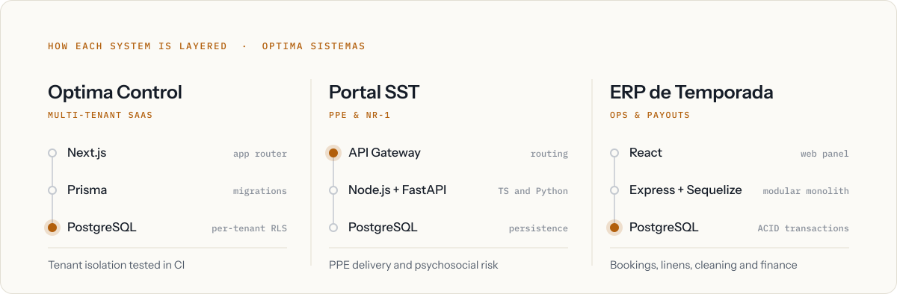
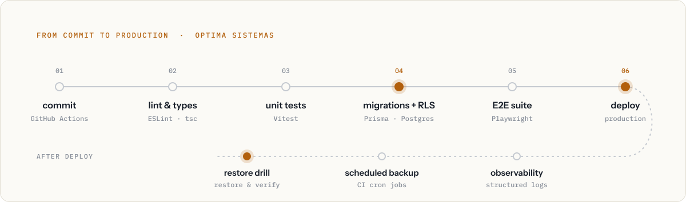
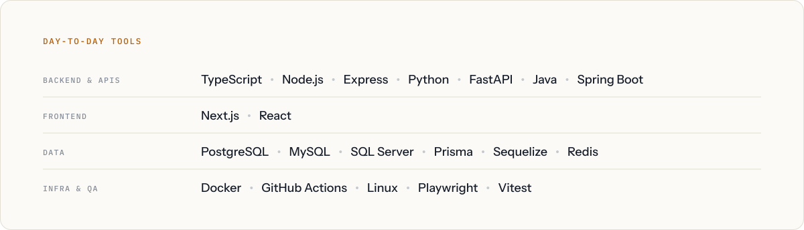

<picture>
  <source media="(prefers-color-scheme: dark)" srcset="./assets/header-dark.en.svg">
  <source media="(prefers-color-scheme: light)" srcset="./assets/header-light.en.svg">
  
</picture>

  <a href="https://optimasistemas.com">optimasistemas.com</a>
  &nbsp;·&nbsp;
  <a href="https://www.linkedin.com/in/matheus-henriquedev/">LinkedIn</a>
  &nbsp;·&nbsp;
  <a href="mailto:matheushenriqueds1223@gmail.com">Email</a>
  &nbsp;·&nbsp;
  <a href="./README.md">Português</a>

## About

I'm a software engineer, systems analyst and founder at **Optima Sistemas**, where I design, architect and operate B2B SaaS products and management platforms for service businesses.

I work across the whole software lifecycle. It starts with analysis and project management (requirements, business process mapping, technical feasibility and delivery coordination) and runs through backend engineering and production operations. My focus is relational data modeling, complex domain rules, multi-tenant isolation and integration between business systems.

B.S. in Computer Science, with a postgraduate degree in Software Architecture and AI.

## Production systems

Proprietary systems I build and maintain at Optima. Because they are commercial products, the source is private. Their architecture and engineering decisions are outlined below.

<picture>
  <source media="(prefers-color-scheme: dark)" srcset="./assets/products-dark.en.svg">
  <source media="(prefers-color-scheme: light)" srcset="./assets/products-light.en.svg">
  
</picture>

**Optima Control** is an operational and financial management platform for pest control companies. Tenant isolation lives inside PostgreSQL itself, through Row-Level Security, and an E2E suite verifies it in CI.

**Portal SST** handles occupational health and safety: PPE delivery, digital signatures and psychosocial risk assessment (NR-1). Services sit behind an API Gateway, with Node.js for transactional flows and FastAPI for specialized processing.

**ERP de Temporada** centralizes bookings, linen inventory, housekeeping schedules and owner payouts. It is a modular monolith built on ACID transactions, so the operational calendar and the financial close never drift apart.

## How I build

<picture>
  <source media="(prefers-color-scheme: dark)" srcset="./assets/pipeline-dark.en.svg">
  <source media="(prefers-color-scheme: light)" srcset="./assets/pipeline-light.en.svg">
  
</picture>

- **Domain apart from infrastructure.** Business rules and use cases don't depend on the HTTP layer or the ORM. Frameworks stay at the edges.
- **Data isolation enforced by the database.** RLS policies in PostgreSQL, audited in CI before every deploy.
- **Versioned schema.** Every structural change is a migration reviewed in a pull request. No automatic schema sync in production.
- **A backup counts only if it restores.** Scheduled snapshots plus automated drills that spin up an isolated instance and verify data integrity.
- **Tests where the risk is.** Fast unit tests for domain calculations and invariants; integration and E2E at critical boundaries such as databases, queues and external APIs.
- **Observability from the first deploy.** Structured logs with request correlation and exception tracking before the system goes live.

## Stack

<picture>
  <source media="(prefers-color-scheme: dark)" srcset="./assets/stack-dark.en.svg">
  <source media="(prefers-color-scheme: light)" srcset="./assets/stack-light.en.svg">
  
</picture>

 

<a href="https://optimasistemas.com">Optima Sistemas</a> &nbsp;·&nbsp; Custom management software

