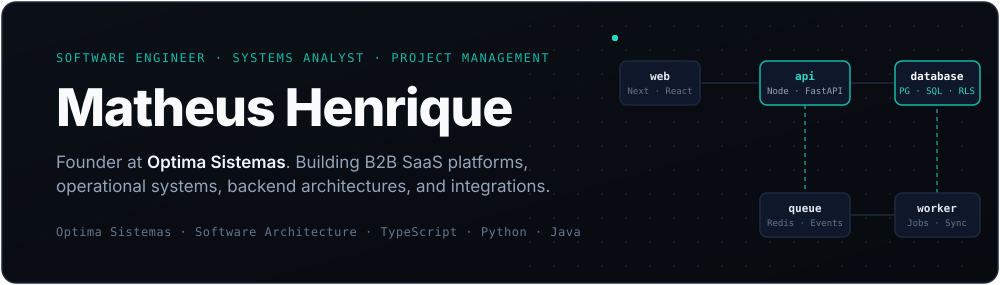
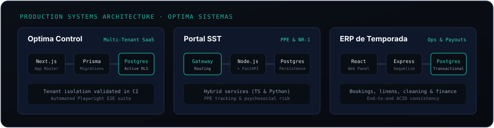
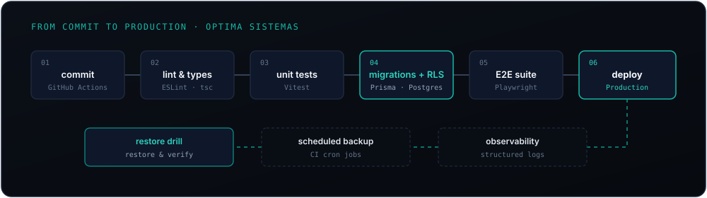

   
  <a href="https://optimasistemas.com"><kbd>&nbsp;&nbsp;optimasistemas.com&nbsp;&nbsp;</kbd></a>
  &nbsp;&nbsp;
  <a href="https://www.linkedin.com/in/matheus-henriquedev/"><kbd>&nbsp;&nbsp;LinkedIn&nbsp;&nbsp;</kbd></a>
  &nbsp;&nbsp;
  <a href="mailto:matheushenriqueds1223@gmail.com"><kbd>&nbsp;&nbsp;matheushenriqueds1223@gmail.com&nbsp;&nbsp;</kbd></a>
  &nbsp;&nbsp;
  <a href="./README.md"><kbd>&nbsp;&nbsp;Português (BR)&nbsp;&nbsp;</kbd></a>

 

## About

Software engineer, systems analyst, and founder at **Optima Sistemas**, where I design, architect, and operate B2B SaaS products and operational management platforms for service-oriented businesses. My work spans the full software lifecycle, from **systems analysis and project management** (requirements discovery, business process mapping, technical feasibility, and delivery coordination) to backend engineering and production operations. I focus on relational data modeling, complex domain rules, multi-tenant data isolation, and reliable integrations across business systems.

<table width="100%">
  <tr>
    <td width="25%" valign="top">
      <b>OPERATION</b> 
      <code>Founder @ Optima Sistemas</code>
    </td>
    <td width="25%" valign="top">
      <b>UNDERGRADUATE</b> 
      <code>B.S. in Computer Science</code>
    </td>
    <td width="25%" valign="top">
      <b>POSTGRADUATE</b> 
      <code>Software Architecture & AI</code>
    </td>
    <td width="25%" valign="top">
      <b>CORE FOCUS</b> 
      <code>Backend, Data & Systems Delivery</code>
    </td>
  </tr>
</table>

 

## Production Systems & Architecture

Proprietary commercial systems designed, built, and maintained in production at **Optima Sistemas**. Because these are commercial B2B products, their source repositories remain private; the architectural topology, domain boundaries, and engineering trade-offs behind each platform are detailed below:

<table width="100%">
  <tr>
    <td width="33.3%" valign="top">
      <b>Optima Control</b> &nbsp;<code>B2B SaaS</code>  
      Operational and financial management platform built for pest control and environmental health companies.  
      <b>Architecture:</b> Multi-tenancy enforced directly at the database layer via PostgreSQL <i>Row-Level Security (RLS)</i>, backed by automated E2E tenant-isolation checks in CI.  
      <code>Next.js</code> <code>Prisma</code> <code>PostgreSQL</code> <code>Playwright</code>
    </td>
    <td width="33.3%" valign="top">
      <b>Portal SST</b> &nbsp;<code>Microservices</code>  
      Occupational health and safety platform for PPE delivery tracking, digital signatures, and psychosocial risk assessments (NR-1 compliance).  
      <b>Architecture:</b> Decoupled services operating behind an API Gateway, combining Node.js for transactional domain workflows and FastAPI for specialized data processing.  
      <code>Node.js</code> <code>Python</code> <code>FastAPI</code> <code>PostgreSQL</code>
    </td>
    <td width="33.3%" valign="top">
      <b>ERP de Temporada</b> &nbsp;<code>Core ERP</code>  
      Centralized property management system handling seasonal bookings, linen inventory, housekeeping schedules, and owner financial payouts.  
      <b>Architecture:</b> Modular monolith engineered around strict ACID transactions to guarantee consistency between operational calendars and financial reconciliation.  
      <code>React</code> <code>Express</code> <code>Sequelize</code> <code>PostgreSQL</code>
    </td>
  </tr>
</table>

 

## Engineering & Operations

<table width="100%">
  <tr>
    <td width="50%" valign="top">
      <code>01</code> &nbsp;<b>Domain decoupled from infrastructure</b>  
      Business rules and use cases are isolated from the HTTP transport layer and ORM specifics. Frameworks and external libraries act strictly as infrastructure details, simplifying testing and long-term maintenance.
    </td>
    <td width="50%" valign="top">
      <code>02</code> &nbsp;<b>Database-enforced tenant isolation</b>  
      <i>Row-Level Security (RLS)</i> policies are enforced directly inside PostgreSQL and audited automatically in the CI pipeline prior to deployment to prevent cross-tenant data leakage.
    </td>
  </tr>
  <tr>
    <td width="50%" valign="top">
      <code>03</code> &nbsp;<b>Controlled schema evolution</b>  
      Every structural database change requires deterministic, versioned migrations reviewed via Pull Request. Automatic schema synchronization is strictly disabled in production environments.
    </td>
    <td width="50%" valign="top">
      <code>04</code> &nbsp;<b>Verified disaster recovery</b>  
      A backup is only valid once restoration is proven. Scheduled database snapshots are paired with automated restore drills that provision an isolated instance and verify data integrity.
    </td>
  </tr>
  <tr>
    <td width="50%" valign="top">
      <code>05</code> &nbsp;<b>Risk-targeted testing strategy</b>  
      Fast unit tests protect core domain calculations and business invariants, while integration and E2E suites target high-risk system boundaries (databases, queues, and external APIs).
    </td>
    <td width="50%" valign="top">
      <code>06</code> &nbsp;<b>Observability from initial deployment</b>  
      Structured logging with request correlation context and exception tracking are configured before go-live, minimizing mean time to diagnosis in production.
    </td>
  </tr>
</table>

 

## Technology Stack

<table width="100%">
  <tr>
    <td width="24%"><b>BACKEND & APIS</b></td>
    <td width="76%">
      
      
      
      
      
      
      
    </td>
  </tr>
  <tr>
    <td><b>FRONTEND</b></td>
    <td>
      
      
    </td>
  </tr>
  <tr>
    <td><b>DATABASES & DATA LAYER</b></td>
    <td>
      
      
      
      
      
      
    </td>
  </tr>
  <tr>
    <td><b>INFRASTRUCTURE, QA & CI/CD</b></td>
    <td>
      
      
      
      
      
    </td>
  </tr>
</table>

 

---

  <b>Optima Sistemas</b> · <a href="https://optimasistemas.com">optimasistemas.com</a> &nbsp;·&nbsp; Direct contact: <a href="https://www.linkedin.com/in/matheus-henriquedev/">LinkedIn</a> &nbsp;·&nbsp; <a href="mailto:matheushenriqueds1223@gmail.com">matheushenriqueds1223@gmail.com</a>

