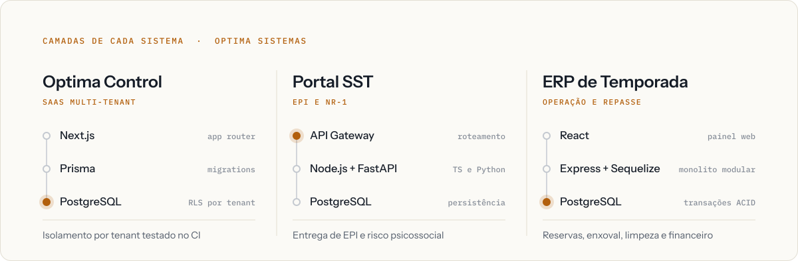
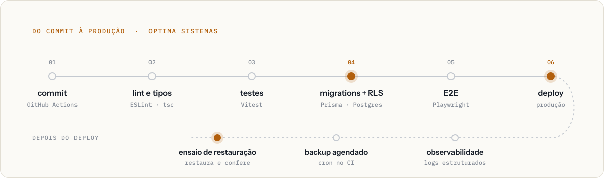
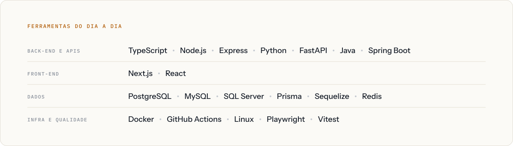

<picture>
  <source media="(prefers-color-scheme: dark)" srcset="./assets/header-dark.svg">
  <source media="(prefers-color-scheme: light)" srcset="./assets/header-light.svg">
  
</picture>

  <a href="https://optimasistemas.com">optimasistemas.com</a>
  &nbsp;·&nbsp;
  <a href="https://www.linkedin.com/in/matheus-henriquedev/">LinkedIn</a>
  &nbsp;·&nbsp;
  <a href="mailto:matheushenriqueds1223@gmail.com">E-mail</a>
  &nbsp;·&nbsp;
  <a href="./README.en.md">English</a>

## Sobre

Sou engenheiro de software, analista de sistemas e fundador da **Optima Sistemas**, onde concebo, arquiteto e opero produtos SaaS B2B e plataformas de gestão para empresas de serviço.

Atuo no ciclo inteiro do software. Começo pela análise e pela gestão do projeto (requisitos, mapeamento de processos, viabilidade técnica e condução das entregas) e sigo até a engenharia back-end e a sustentação em produção. O foco está em modelagem relacional, regras de domínio complexas, isolamento multi-tenant e integração entre sistemas.

Bacharel em Ciência da Computação, com pós-graduação em Arquitetura de Software e IA.

## Produtos em produção

Sistemas proprietários que desenvolvo e mantenho na Optima. Por serem produtos comerciais, o código é privado. Abaixo estão a arquitetura e as decisões técnicas de cada um.

<picture>
  <source media="(prefers-color-scheme: dark)" srcset="./assets/products-dark.svg">
  <source media="(prefers-color-scheme: light)" srcset="./assets/products-light.svg">
  
</picture>

**Optima Control** é a plataforma de gestão operacional e financeira para controladoras de pragas. O isolamento entre clientes fica no próprio PostgreSQL, com Row-Level Security, e uma suíte E2E confere esse isolamento no CI.

**Portal SST** cuida de saúde e segurança do trabalho: entrega de EPI, assinatura digital e avaliação de risco psicossocial (NR-1). Os serviços ficam atrás de um API Gateway, com Node.js nos fluxos transacionais e FastAPI no processamento especializado.

**ERP de Temporada** centraliza reservas, enxoval, escala de limpeza e repasse aos proprietários. É um monolito modular apoiado em transações ACID, para que calendário operacional e fechamento financeiro nunca divirjam.

## Como eu construo

<picture>
  <source media="(prefers-color-scheme: dark)" srcset="./assets/pipeline-dark.svg">
  <source media="(prefers-color-scheme: light)" srcset="./assets/pipeline-light.svg">
  
</picture>

- **Domínio separado da infraestrutura.** Regras de negócio e casos de uso não dependem da camada HTTP nem do ORM. Framework é detalhe de borda.
- **Isolamento de dados garantido no banco.** Políticas de RLS no PostgreSQL, auditadas no CI antes de cada deploy.
- **Schema versionado.** Toda mudança estrutural vira migration revisada em pull request. Nada de sincronização automática em produção.
- **Backup só vale se restaura.** Snapshots agendados e ensaios automáticos que sobem uma instância isolada e conferem a integridade dos dados.
- **Teste onde está o risco.** Unitários rápidos para cálculos e invariantes do domínio; integração e E2E nas bordas críticas, como banco, filas e APIs externas.
- **Observabilidade desde o primeiro deploy.** Logs estruturados com correlação de requisição e rastreamento de exceções antes de o sistema entrar no ar.

## Stack

<picture>
  <source media="(prefers-color-scheme: dark)" srcset="./assets/stack-dark.svg">
  <source media="(prefers-color-scheme: light)" srcset="./assets/stack-light.svg">
  
</picture>

 

<a href="https://optimasistemas.com">Optima Sistemas</a> &nbsp;·&nbsp; Software de gestão sob medida

