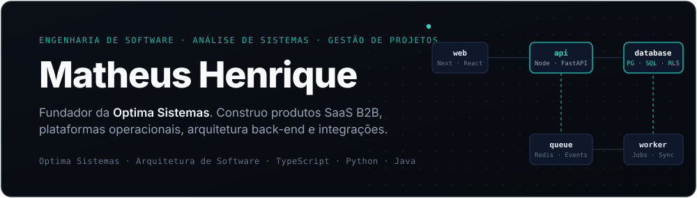
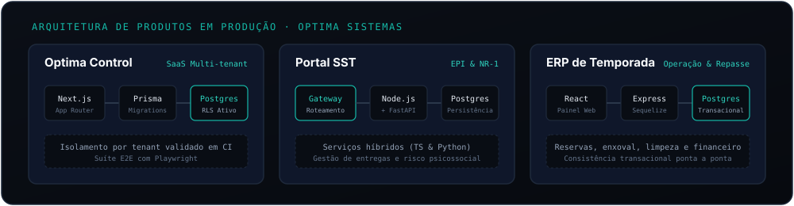
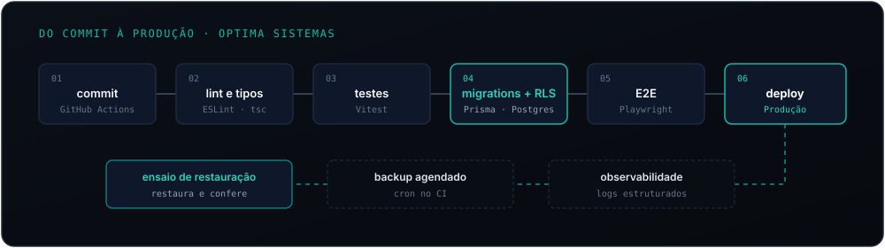

   
  <a href="https://optimasistemas.com"><kbd>&nbsp;&nbsp;optimasistemas.com&nbsp;&nbsp;</kbd></a>
  &nbsp;&nbsp;
  <a href="https://www.linkedin.com/in/matheus-henriquedev/"><kbd>&nbsp;&nbsp;LinkedIn&nbsp;&nbsp;</kbd></a>
  &nbsp;&nbsp;
  <a href="mailto:matheushenriqueds1223@gmail.com"><kbd>&nbsp;&nbsp;matheushenriqueds1223@gmail.com&nbsp;&nbsp;</kbd></a>
  &nbsp;&nbsp;
  <a href="./README.en.md"><kbd>&nbsp;&nbsp;English&nbsp;&nbsp;</kbd></a>

 

## Sobre

Engenheiro de software, analista de sistemas e fundador na **Optima Sistemas**, onde concebo, arquiteto e opero produtos SaaS B2B e plataformas de gestão operacional para empresas de serviços. Atuo em todo o ciclo de vida do software: da **análise de sistemas e gestão de projetos** (levantamento de requisitos, mapeamento de processos de negócio, viabilidade técnica e condução de entregas) à engenharia back-end e sustentação em produção, com foco em modelagem relacional, regras de domínio complexas, isolamento multi-tenant e integrações entre sistemas.

<table width="100%">
  <tr>
    <td width="25%" valign="top">
      <b>OPERAÇÃO</b> 
      <code>Fundador @ Optima Sistemas</code>
    </td>
    <td width="25%" valign="top">
      <b>GRADUAÇÃO</b> 
      <code>Ciência da Computação</code>
    </td>
    <td width="25%" valign="top">
      <b>PÓS-GRADUAÇÃO</b> 
      <code>Arquitetura de Software & IA</code>
    </td>
    <td width="25%" valign="top">
      <b>FOCO TÉCNICO</b> 
      <code>Back-end, Dados & Gestão</code>
    </td>
  </tr>
</table>

 

## Produtos & Arquitetura em Produção

Sistemas proprietários desenvolvidos e mantidos em produção na **Optima Sistemas**. Como são produtos comerciais B2B, os repositórios são privados; a topologia arquitetural, as fronteiras de domínio e as decisões de engenharia de cada plataforma estão detalhadas abaixo:

<table width="100%">
  <tr>
    <td width="33.3%" valign="top">
      <b>Optima Control</b> &nbsp;<code>SaaS B2B</code>  
      Plataforma de gestão operacional e financeira para controladoras de pragas e dedetizadoras.  
      <b>Arquitetura:</b> Multi-tenancy com isolamento imposto diretamente no banco via <i>Row-Level Security (RLS)</i> e validação E2E automatizada no pipeline de CI.  
      <code>Next.js</code> <code>Prisma</code> <code>PostgreSQL</code> <code>Playwright</code>
    </td>
    <td width="33.3%" valign="top">
      <b>Portal SST</b> &nbsp;<code>Microsserviços</code>  
      Plataforma de saúde e segurança do trabalho para gestão de entregas de EPIs, assinaturas digitais e avaliação de riscos psicossociais (NR-1).  
      <b>Arquitetura:</b> Serviços desacoplados operando atrás de um API Gateway, combinando Node.js para fluxos transacionais e FastAPI para processamento especializado.  
      <code>Node.js</code> <code>Python</code> <code>FastAPI</code> <code>PostgreSQL</code>
    </td>
    <td width="33.3%" valign="top">
      <b>ERP de Temporada</b> &nbsp;<code>Core Operacional</code>  
      Sistema centralizado de gestão de reservas, controle de enxoval, escala de governança/limpeza e repasse financeiro a proprietários.  
      <b>Arquitetura:</b> Monolito modular orientado a transações ACID para garantir consistência estrita entre calendário operacional e fechamento financeiro.  
      <code>React</code> <code>Express</code> <code>Sequelize</code> <code>PostgreSQL</code>
    </td>
  </tr>
</table>

 

## Engenharia & Operação

<table width="100%">
  <tr>
    <td width="50%" valign="top">
      <code>01</code> &nbsp;<b>Domínio desacoplado da infraestrutura</b>  
      Regras de negócio e casos de uso isolados da camada HTTP e do ORM. Frameworks e bibliotecas externas atuam estritamente como detalhes de infraestrutura, facilitando evolução e testes.
    </td>
    <td width="50%" valign="top">
      <code>02</code> &nbsp;<b>Isolamento de dados garantido no banco</b>  
      Políticas de <i>Row-Level Security (RLS)</i> aplicadas diretamente no PostgreSQL e auditadas automaticamente no CI antes de cada deploy para impedir vazamento entre tenants.
    </td>
  </tr>
  <tr>
    <td width="50%" valign="top">
      <code>03</code> &nbsp;<b>Evolução controlada de schema</b>  
      Qualquer alteração estrutural de banco passa obrigatoriamente por migrations determinísticas e revisáveis em Pull Request. Zero sincronização automática em produção.
    </td>
    <td width="50%" valign="top">
      <code>04</code> &nbsp;<b>Recuperação de desastres validada</b>  
      Backup só é válido quando a restauração é provada. Snapshots agendados são acompanhados de ensaios automatizados que sobem uma instância isolada e verificam a integridade dos dados.
    </td>
  </tr>
  <tr>
    <td width="50%" valign="top">
      <code>05</code> &nbsp;<b>Testes direcionados ao risco real</b>  
      Testes unitários rápidos blindam cálculos e invariantes de domínio, enquanto suítes de integração e E2E cobrem as fronteiras críticas (banco de dados, filas e APIs externas).
    </td>
    <td width="50%" valign="top">
      <code>06</code> &nbsp;<b>Observabilidade desde o primeiro deploy</b>  
      Logs estruturados com contexto de correlação de requisição e rastreamento de exceções configurados antes de o sistema entrar no ar, reduzindo o tempo médio de diagnóstico em produção.
    </td>
  </tr>
</table>

 

## Stack Tecnológica

<table width="100%">
  <tr>
    <td width="24%"><b>BACK-END & APIS</b></td>
    <td width="76%">
      
      
      
      
      
      
      
    </td>
  </tr>
  <tr>
    <td><b>FRONT-END</b></td>
    <td>
      
      
    </td>
  </tr>
  <tr>
    <td><b>BANCOS DE DADOS & DADOS</b></td>
    <td>
      
      
      
      
      
      
    </td>
  </tr>
  <tr>
    <td><b>INFRA, QA & CI/CD</b></td>
    <td>
      
      
      
      
      
    </td>
  </tr>
</table>

 

---

  <b>Optima Sistemas</b> · <a href="https://optimasistemas.com">optimasistemas.com</a> &nbsp;·&nbsp; Contato direto: <a href="https://www.linkedin.com/in/matheus-henriquedev/">LinkedIn</a> &nbsp;·&nbsp; <a href="mailto:matheushenriqueds1223@gmail.com">matheushenriqueds1223@gmail.com</a>

