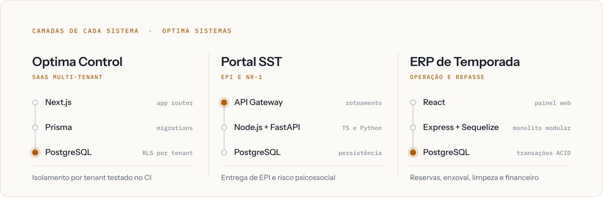
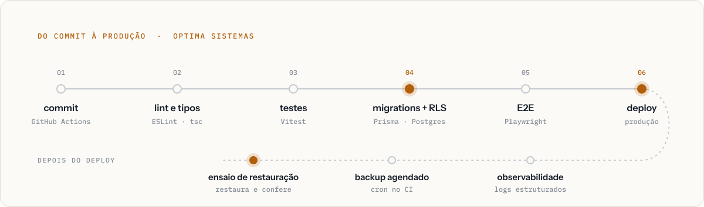
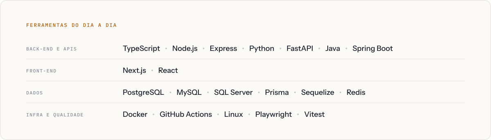

<picture>
  <source media="(prefers-color-scheme: dark)" srcset="./assets/header-dark.svg">
  <source media="(prefers-color-scheme: light)" srcset="./assets/header-light.svg">
  
</picture>

  

  
  
  
  

---

## Sobre mim

Sou **desenvolvedor full stack**, analista de sistemas e fundador da **Optima Sistemas**, empresa especializada na criação, arquitetura e operação de **produtos SaaS B2B** e sistemas de gestão corporativa sob medida.

Atuo em todo o ciclo de desenvolvimento de software — da análise de requisitos, mapeamento de processos e modelagem de dados até o desenvolvimento front-end, construção de APIs back-end e sustentação em ambientes de produção. Meu foco técnico está em **interfaces funcionais**, **modelagem relacional avançada**, **regras de domínio complexas**, **isolamento multi-tenant** e **integração entre sistemas**.

> **Formação acadêmica:** Bacharel em Ciência da Computação, com pós-graduação em Arquitetura de Software e Inteligência Artificial.

---

## Produtos em produção

Plataformas proprietárias que idealizei, desenvolvo e mantenho na **Optima Sistemas**. Por serem produtos comerciais ativos, o código-fonte é privado; abaixo estão o contexto de negócio e as decisões de arquitetura de cada sistema.

<picture>
  <source media="(prefers-color-scheme: dark)" srcset="./assets/products-dark.svg">
  <source media="(prefers-color-scheme: light)" srcset="./assets/products-light.svg">
  
</picture>

### Optima Control
Gestão operacional e financeira para empresas controladoras de pragas &nbsp;·&nbsp; Next.js, Prisma, PostgreSQL (RLS)

Plataforma SaaS multi-tenant onde o isolamento de dados entre clientes ocorre nativamente no **PostgreSQL** por meio de políticas de **Row-Level Security (RLS)**, validado automaticamente por uma suíte de testes E2E no pipeline de CI/CD.

### Portal SST
Saúde e segurança do trabalho: controle de EPIs, assinatura digital e risco psicossocial (NR-1) &nbsp;·&nbsp; API Gateway, Node.js, FastAPI, PostgreSQL

Arquitetura distribuída atrás de um **API Gateway**, combinando **Node.js** nos fluxos transacionais do dia a dia com **Python (FastAPI)** no processamento analítico e rotinas especializadas.

### ERP de Temporada
Centralização de reservas, controle de enxoval, escala de limpeza e repasse financeiro &nbsp;·&nbsp; React, Express, Sequelize, PostgreSQL

Monolito modular construído sobre **transações ACID**, garantindo consistência absoluta entre o calendário operacional de hospedagens e o fechamento financeiro dos proprietários.

---

## Como eu construo software

<picture>
  <source media="(prefers-color-scheme: dark)" srcset="./assets/pipeline-dark.svg">
  <source media="(prefers-color-scheme: light)" srcset="./assets/pipeline-light.svg">
  
</picture>

- **Domínio separado da infraestrutura:** Regras de negócio e casos de uso desacoplados da camada HTTP e do ORM. Framework é detalhe de borda.
- **Isolamento de dados garantido no banco:** Políticas de Row-Level Security (RLS) no PostgreSQL auditadas no CI antes de cada deploy.
- **Schema versionado:** Toda mudança estrutural vira migration revisada em pull request, sem sincronização automática em produção.
- **Backup só vale se restaura:** Snapshots agendados acompanhados de ensaios automáticos que sobem uma instância isolada e validam a integridade dos dados.
- **Teste onde está o risco:** Testes unitários rápidos para regras e invariantes do domínio; integração e E2E nas bordas críticas (banco de dados, filas e APIs externas).
- **Observabilidade desde o primeiro deploy:** Logs estruturados com correlação de requisição e rastreamento de exceções antes de o sistema entrar no ar.

---

## Stack tecnológica

<picture>
  <source media="(prefers-color-scheme: dark)" srcset="./assets/stack-dark.svg">
  <source media="(prefers-color-scheme: light)" srcset="./assets/stack-light.svg">
  
</picture>

 

  
  

 

  

  <a href="https://optimasistemas.com"><strong>Optima Sistemas</strong></a> &nbsp;·&nbsp; Desenvolvimento Full Stack, Arquitetura SaaS e Software de Gestão sob Medida

